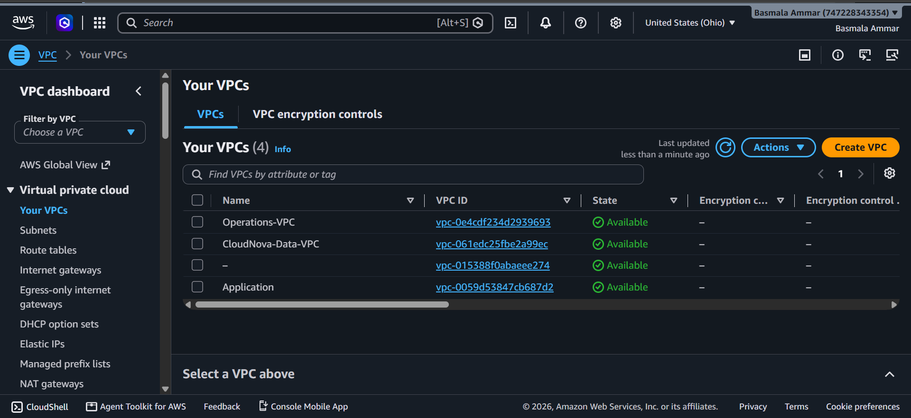
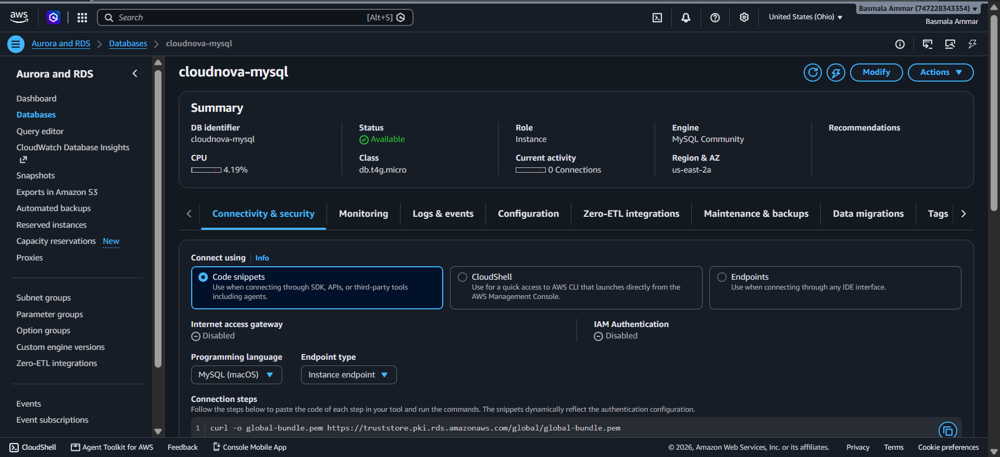
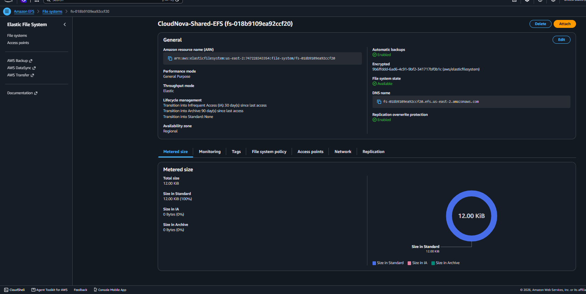
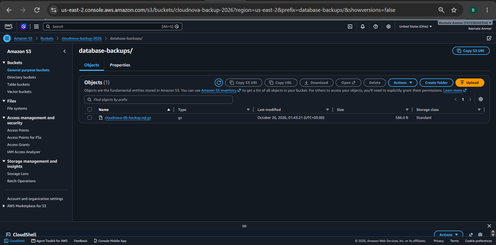
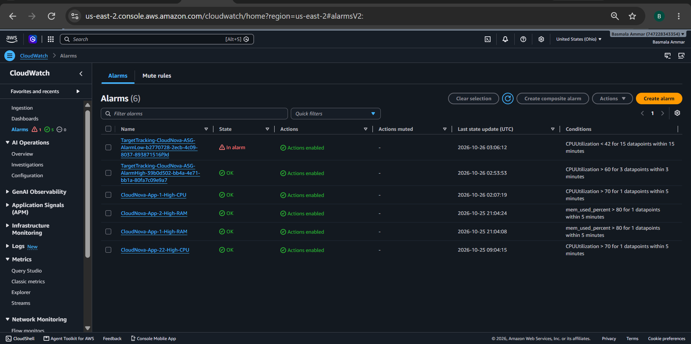
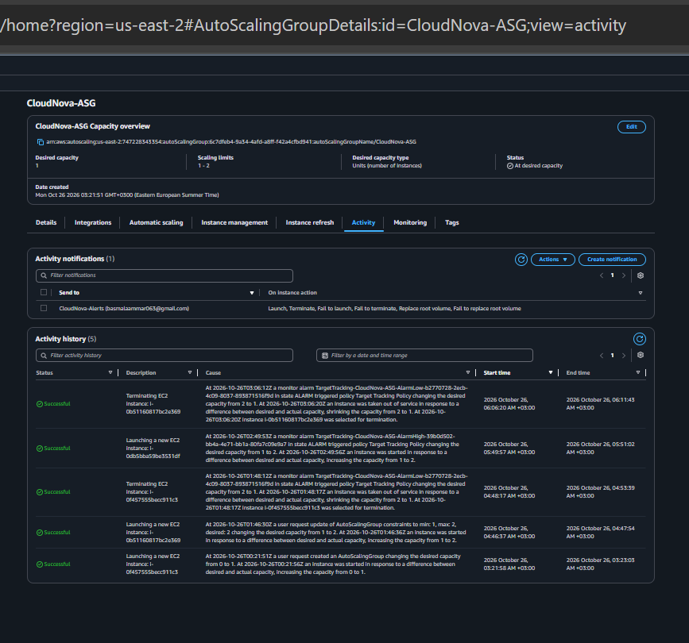

# CloudNova Enterprise AWS Infrastructure

A secure, scalable, and monitored cloud infrastructure built using Amazon Web Services (AWS).

## Table of Contents

- [Project Overview](#project-overview)
- [Project Objectives](#project-objectives)
- [Architecture](#architecture)
- [AWS Services](#aws-services)
- [Network Design](#network-design)
- [Application and Load Balancing](#application-and-load-balancing)
- [Database and Storage](#database-and-storage)
- [Monitoring and Notifications](#monitoring-and-notifications)
- [Auto Scaling](#auto-scaling)
- [Security](#security)
- [Testing and Validation](#testing-and-validation)
- [Limitations and Future Improvements](#limitations-and-future-improvements)
- [Conclusion](#conclusion)

## Project Overview

CloudNova Enterprise AWS Infrastructure is a cloud infrastructure project designed to host a web application using AWS services.

The infrastructure focuses on network isolation, controlled communication, shared storage, database backups, monitoring, email notifications, and automatic scaling.

**AWS Region:** US East (Ohio) — `us-east-2`

## Project Objectives

- Design a secure multi-VPC network.
- Host application servers in private subnets.
- Distribute incoming HTTP traffic through an Application Load Balancer.
- Isolate database resources from direct public access.
- Provide shared storage for application servers.
- Store database backups in Amazon S3.
- Monitor CPU and memory utilization.
- Send infrastructure notifications using Amazon SNS.
- Scale application capacity based on CPU utilization.
- Manage EC2 instances through AWS Systems Manager.

## Architecture

The project contains three VPCs:

1. **Application VPC:** Hosts the application servers, load balancer connectivity, and application networking.
2. **Data VPC:** Isolates database resources in private subnets.
3. **Operations VPC:** Provides a separate network for future operational resources and tooling.

VPC Peering connects the Application VPC to the Data VPC and Operations VPC. Route tables control traffic between the connected networks.

The Application Load Balancer receives HTTP requests and forwards them to registered targets in the target group.

Application servers communicate with Amazon RDS for database operations. Amazon EFS provides shared file storage, while Amazon S3 stores database backup files.

CloudWatch monitors resource metrics, and SNS sends notifications to the configured email address.

AWS console screenshots documenting the implemented infrastructure and test results are available in the Project Screenshots section below. An architecture diagram remains a future improvement.
## AWS Services

| AWS Service | Purpose |
|---|---|
| Amazon VPC | Network isolation and subnet organization |
| VPC Peering | Private connectivity between VPCs |
| Amazon EC2 | Application server hosting |
| Application Load Balancer | Distributes incoming HTTP traffic |
| EC2 Auto Scaling | Adjusts application capacity based on demand |
| Amazon RDS for MySQL | Managed relational database |
| Amazon EFS | Shared file storage |
| Amazon S3 | Database backup storage |
| Amazon CloudWatch | Metrics, alarms, and monitoring |
| Amazon SNS | Email notifications |
| AWS Systems Manager | Secure instance administration |
| VPC Endpoints | Private access to supported AWS services |

## Network Design

The infrastructure uses separate VPCs and private subnets to isolate application, data, and operational resources.

### Application VPC

- VPC CIDR: `10.10.0.0/16`
- Public subnets: `10.10.1.0/24` and `10.10.2.0/24`
- Private application subnets: `10.10.11.0/24` and `10.10.12.0/24`
- Internet Gateway attached for public-subnet connectivity.
- Private application route table configured for VPC Peering and an S3 Gateway Endpoint.
- Interface VPC endpoints configured for Systems Manager and CloudWatch Monitoring.

### Data VPC

- VPC CIDR: `10.20.0.0/16`
- Private subnets: `10.20.1.0/24` and `10.20.2.0/24`
- No Internet Gateway or NAT Gateway configured.
- Routes configured for private communication with the Application VPC.

### Operations VPC

- VPC CIDR: `10.30.0.0/16`
- Private subnets: `10.30.1.0/24` and `10.30.2.0/24`
- VPC Peering configured with the Application VPC.
- Reserved for operational resources and future tooling.

Security groups restrict communication to the required traffic and authorized sources.

## Application and Load Balancing

The application is hosted on Amazon EC2 instances in private subnets.

The Application Load Balancer is internet-facing and receives HTTP traffic on port 80. It forwards requests to the `CloudNova-TG` target group.

The target group health checks were verified, and the registered targets were observed in the Healthy state.

The application website was successfully accessed through the load balancer.

## Database and Storage

### Amazon RDS

Amazon RDS for MySQL hosts the relational database.

The database is deployed in the Data VPC, and its security group restricts MySQL access to the authorized application subnet ranges.

Database connectivity was tested from an application server.

### Amazon EFS

Amazon EFS provides shared file storage across application servers.

A shared-file test was performed to verify that a file created on one application server could be accessed from another application server.

### Amazon S3

Amazon S3 stores database backup files in the `cloudnova-backup-2026` bucket.

A compressed database dump was uploaded to:

`database-backups/cloudnova-db-backup.sql.gz`

The uploaded object was verified in S3.

An S3 lifecycle rule named `CloudNova-Backup-Lifecycle` is configured to transition objects under the `database-backups` prefix to S3 Standard-IA after 30 days.

Automated RDS backups are also enabled.

**Backup note:** The tested database dump was created while the `cloudnova_app` database was empty. A populated-data backup and restore test remain useful future validation steps.

## Monitoring and Notifications

Amazon CloudWatch is used to monitor infrastructure metrics.

Configured alarms include:

- `CloudNova-App-1-High-CPU`
- `CloudNova-App-22-High-CPU`
- `CloudNova-App-1-High-RAM`
- `CloudNova-App-2-High-RAM`

The CPU alarms use a threshold above 70% over a five-minute evaluation period. The RAM alarms use `mem_used_percent` above 80% over a five-minute evaluation period.

The CloudWatch Agent collects memory metrics.

Amazon SNS uses the `CloudNova-Alerts` topic to deliver notifications to the configured email subscription. The notification delivery path was tested successfully.

## Auto Scaling

The `CloudNova-ASG` Auto Scaling group manages application capacity using a target tracking policy.

Configuration:

| Setting | Value |
|---|---|
| Minimum capacity | 1 instance |
| Desired capacity | 1 instance |
| Maximum capacity | 2 instances |
| Target average CPU utilization | 60% |
| Health check types | EC2 and ELB |
| Health check grace period | 300 seconds |

A scaling test successfully increased the desired capacity from one instance to two instances under high CPU load. The group later scaled back to one instance when CPU demand decreased.

The Auto Scaling group has activity notifications configured for launch, termination, and selected failure events.

**Self-healing status:** Automatic replacement following an unhealthy-instance health check has not yet been independently demonstrated.

## Security

The project applies the following security measures:

- Private subnets for application and database resources.
- Security groups restricting inbound traffic.
- Database access limited to authorized application subnet ranges.
- Systems Manager for administrative access without requiring a public IP on private application instances.
- VPC endpoints for supported private access to AWS services.
- S3 Gateway Endpoint routing for S3 access from the private application route table.

Access permissions should follow the principle of least privilege.

## Testing and Validation

The following tests and checks were performed:

| Test | Result |
|---|---|
| Access application through the ALB | Successful |
| Verify target group health | Healthy targets observed |
| Test application-to-database connectivity | Successful |
| Test shared EFS file access | Successful |
| Upload and verify database backup in S3 | Successful |
| Verify CloudWatch alarms and SNS notification path | Successful |
| Test Auto Scaling from one instance to two | Successful |
| Observe scale-in after CPU demand decreased | Successful |
| Independently test unhealthy-instance replacement | Not yet tested |
| Perform a populated database backup and restore test | Not yet tested |

## Limitations and Future Improvements

- Demonstrate automatic replacement after an EC2 or load balancer health-check failure.
- Test database backup restoration using a database containing sample records.
- Add an architecture diagram and screenshots of important AWS configurations.
- Review resource costs and remove unused resources after the project demonstration.
- Consider additional operational tooling if required by the project specification.

## Conclusion

CloudNova demonstrates how AWS networking, compute, database, storage, monitoring, notifications, and scaling services can be combined into a cloud infrastructure.

The project includes private networking, load balancing, managed database connectivity, shared storage, S3 backups, CloudWatch alarms, SNS notifications, and tested Auto Scaling behavior.

The documented test results distinguish verified behavior from features that still require additional validation.
## Project Screenshots

The following screenshots provide visual evidence of the AWS configuration and validation activities.

### 1. VPC Network Overview

### 2. Application Load Balancer Target Group

### 3. Amazon RDS Database

### 4. Amazon EFS Shared Storage

### 5. Amazon S3 Database Backup

### 6. CloudWatch Monitoring Alarms

### 7. Auto Scaling Activity History

